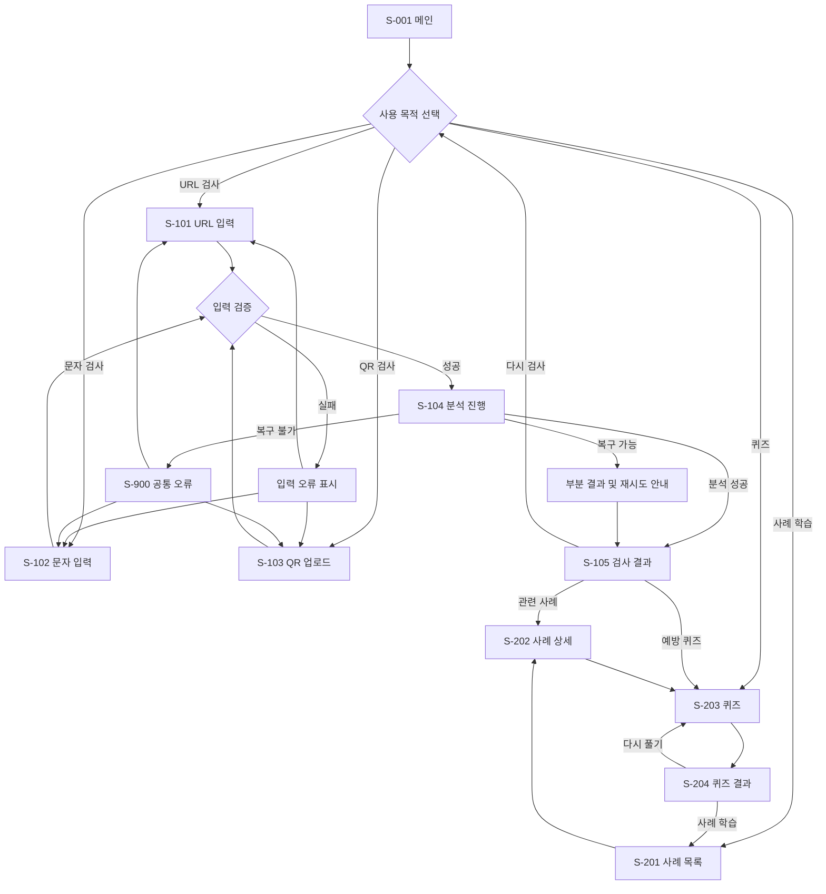

# 스미싱 예방 교육 및 탐지 시스템 사용자 흐름

- **문서 버전:** Draft v0.4
- **작성일:** 2026-10-11
- **검토 상태:** 팀 합의 전 제안안
- **관련 문서:** `01_Feature_Specification.md`
- **적용 범위:** MVP 사용자 흐름

## 1. 문서 개요

### 1.1 목적

본 문서는 사용자가 스미싱 예방 교육 및 탐지 시스템에 접속한 뒤 URL, 문자 메시지 또는 QR 코드를 검사하고, 결과와 대응 방법을 확인하는 전체 흐름을 정의한다.

Frontend는 본 문서의 화면과 사용자 동작을 기준으로 UI를 설계하고, Backend는 각 단계에서 필요한 분석 처리와 오류 응답을 설계한다.

### 1.2 핵심 사용자 경험

MVP의 핵심 사용자 경험은 다음과 같다.

```text
의심 자료 제출
→ 입력 검증
→ 위험 요소 분석
→ 위험 등급과 판단 근거 확인
→ 권장 행동 확인
→ 관련 예방 교육 또는 퀴즈 이용
```

### 1.3 설계 원칙

- 회원가입 없이 핵심 검사와 교육 기능을 이용할 수 있어야 한다.
- 사용자가 의심 링크를 직접 열지 않고도 URL과 QR 데이터를 확인할 수 있어야 한다.
- 모든 검사 결과는 위험 등급뿐 아니라 판단 근거와 권장 행동을 제공해야 한다.
- 오류 발생 시 입력값을 가능한 한 유지하고 재시도 방법을 안내해야 한다.
- 검사, 결과, 교육 기능 사이의 이동 경로를 명확하게 제공해야 한다.
- 결과는 확정 판정이 아닌 참고 정보임을 명시해야 한다.

### 1.4 확정된 화면 구조

MVP에서는 검사 유형별 입력 화면을 독립된 경로로 구성하고 검사 결과 화면은 공통으로 사용한다.

```text
/                    메인
/analyze/url         URL 검사
/analyze/message     문자 검사
/analyze/qr          QR 검사
/analyze/result      공통 검사 결과
/education           교육 사례 목록
/education/{id}      교육 사례 상세
/quiz                퀴즈
/quiz/result         퀴즈 결과
```

분리 원칙은 다음과 같다.

- URL, 문자, QR 검사는 입력 방식과 검증 규칙이 다르므로 별도 페이지로 구성한다.
- 헤더 또는 검사 메뉴를 통해 세 검사 페이지 사이를 이동할 수 있도록 한다.
- 결과 화면은 공통 레이아웃과 컴포넌트를 사용하되 검사 유형별 세부 결과 영역만 변경한다.
- 검사 원문과 분석 결과를 URL 쿼리 문자열에 포함하지 않는다.
- 결과 데이터가 없는 상태로 결과 경로에 접근하면 검사 선택 화면으로 안내한다.

## 2. 사용자 유형 및 진입 경로

### 2.1 MVP 사용자

MVP에서는 로그인하지 않은 일반 사용자를 기본 사용자로 정의한다.

사용자는 다음 목적으로 서비스에 진입할 수 있다.

- 의심스러운 URL 검사
- 문자 또는 메신저 내용 검사
- QR 코드 이미지 검사
- 스미싱 사례와 예방수칙 학습
- 예방 퀴즈 풀이

### 2.2 주요 진입 경로

```text
메인 화면
├─ URL 검사
├─ 문자 검사
├─ QR 검사
├─ 스미싱 사례 학습
└─ 예방 퀴즈
```

검사 결과 화면에서도 관련 사례와 퀴즈로 이동할 수 있다.

## 3. 화면 목록

### S-001 메인 화면

- **관련 기능:** F-001
- **경로:** `/`
- **목적:** 서비스 소개와 핵심 기능 진입점 제공
- **주요 요소:**
  - 서비스 소개
  - URL 검사 버튼
  - 문자 검사 버튼
  - QR 검사 버튼
  - 스미싱 사례 학습 버튼
  - 예방 퀴즈 버튼
  - 참고용 결과 및 개인정보 입력 주의 안내

### S-101 URL 검사 화면

- **관련 기능:** F-002, F-003, F-101
- **경로:** `/analyze/url`
- **목적:** 검사할 URL 입력 및 분석 요청
- **주요 요소:**
  - URL 입력 필드
  - 입력 예시
  - 검사 버튼
  - 개인정보 및 로그인 정보 입력 금지 안내
  - 입력 오류 메시지

### S-102 문자 검사 화면

- **관련 기능:** F-002, F-003, F-102
- **경로:** `/analyze/message`
- **목적:** 문자 또는 메신저 내용 입력 및 분석 요청
- **주요 요소:**
  - 여러 줄 텍스트 입력 영역
  - 현재 글자 수와 최대 5,000자 표시
  - 검사 버튼
  - 개인정보 제거 안내
  - 입력 오류 메시지

### S-103 QR 검사 화면

- **관련 기능:** F-002, F-003, F-103
- **경로:** `/analyze/qr`
- **목적:** QR 코드 이미지 업로드 및 분석 요청
- **주요 요소:**
  - 파일 선택 및 드래그 앤 드롭 영역
  - PNG·JPG·JPEG, 최대 10MB 및 최대 4096×4096 안내
  - 이미지 미리보기
  - 선택 파일 삭제 및 교체
  - 검사 버튼
  - 업로드 이미지 처리·삭제 안내

### S-104 분석 진행 상태

- **관련 기능:** F-004, NFR-002
- **경로:** 각 검사 화면 내부 상태
- **목적:** 분석 요청 처리 중 사용자에게 진행 상태 제공
- **주요 요소:**
  - 분석 중 메시지
  - 로딩 표시
  - 중복 제출 방지
  - 처리 지연 안내

MVP에서는 별도 진행 페이지를 만들지 않고 각 검사 화면 안에서 로딩 상태를 표시한다. 처리 중에는 검사 버튼과 입력 변경을 비활성화해 중복 요청을 방지한다.

### S-105 공통 검사 결과 화면

- **관련 기능:** F-004
- **경로:** `/analyze/result`
- **목적:** 검사 유형과 관계없이 일관된 분석 결과 제공
- **주요 요소:**
  - 위험 등급: 안전 / 주의 / 위험
  - 위험 점수: 0~100점
  - 결과 한 줄 요약
  - 탐지된 위험 요소와 판단 근거
  - 검사 유형별 세부 결과
  - 권장 행동
  - 검사 시각
  - 참고용 결과 안내
  - 다시 검사하기
  - 다른 유형 검사하기
  - 관련 사례 보기
  - 예방 퀴즈 풀기

### S-201 교육 사례 목록 화면

- **관련 기능:** F-201
- **경로:** `/education`
- **목적:** 스미싱 유형별 사례 탐색
- **주요 요소:**
  - 사례 유형 필터
  - 사례 카드 목록
  - 유형과 간단한 설명
  - 사례 상세 이동

### S-202 교육 사례 상세 화면

- **관련 기능:** F-201, F-202
- **경로:** `/education/{id}`
- **목적:** 실제 사례의 위험 신호와 대응 방법 학습
- **주요 요소:**
  - 예시 메시지
  - 의심해야 할 문구와 URL 특징
  - 피해 발생 과정
  - 올바른 확인 방법
  - 피해 예방 및 발생 후 대응 방법
  - 관련 퀴즈 이동

### S-203 퀴즈 화면

- **관련 기능:** F-203
- **경로:** `/quiz`
- **목적:** 사용자의 스미싱 식별 능력 점검
- **주요 요소:**
  - 진행 중인 문제 번호와 전체 문제 수
  - 객관식 또는 OX 문제
  - 답안 선택
  - 이전·다음 문제 이동
  - 최종 제출

### S-204 퀴즈 결과 화면

- **관련 기능:** F-203
- **경로:** `/quiz/result`
- **목적:** 점수와 문제별 해설 제공
- **주요 요소:**
  - 점수와 정답 개수
  - 문제별 정답, 사용자 답안 및 해설
  - 부족한 유형과 추천 교육 콘텐츠
  - 다시 풀기
  - 사례 학습 이동

### S-900 공통 오류 상태

- **관련 기능:** F-003, F-004, NFR-002
- **목적:** 복구할 수 없는 오류와 대응 방법 안내
- **주요 요소:**
  - 오류 원인
  - 재시도
  - 이전 화면으로 이동
  - 메인 화면으로 이동

별도 페이지가 필요하지 않은 입력 오류는 해당 입력 화면에서 인라인 메시지로 표시한다.

## 4. 전체 사용자 흐름



## 5. URL 검사 흐름

### 5.1 정상 흐름

1. 사용자가 S-001에서 URL 검사를 선택한다.
2. 시스템이 S-101을 표시한다.
3. 사용자가 검사할 URL을 입력한다.
4. 사용자가 검사 버튼을 누른다.
5. 시스템이 빈 값, 프로토콜 및 URL 형식을 검증한다.
6. 검증에 성공하면 S-104 상태를 표시하고 분석을 요청한다.
7. 시스템이 URL 구조와 도메인 특징을 분석한다.
8. 필요한 경우 외부 악성 URL 평판 조회를 시도한다.
9. 시스템이 위험 점수와 등급을 계산한다.
10. S-105에서 판정 근거와 권장 행동을 표시한다.

### 5.2 입력 오류 흐름

```text
빈 값 또는 잘못된 URL
→ 입력 항목 아래에 오류 원인 표시
→ 기존 입력값 유지
→ 사용자 수정
→ 재검사
```

### 5.3 외부 분석 실패 흐름

외부 평판 조회가 실패해도 내부 규칙 기반 분석을 완료할 수 있으면 결과를 제공한다. 결과 화면에는 외부 조회가 포함되지 않았음을 표시한다.

## 6. 문자 메시지 검사 흐름

### 6.1 정상 흐름

1. 사용자가 S-001에서 문자 검사를 선택한다.
2. 시스템이 S-102를 표시한다.
3. 사용자가 문자 또는 메신저 내용을 붙여넣는다.
4. 시스템이 글자 수를 실시간으로 표시한다.
5. 사용자가 검사 버튼을 누른다.
6. 시스템이 빈 값과 최대 5,000자 제한을 검증한다.
7. 시스템이 위험 키워드와 문장 패턴을 분석한다.
8. 시스템이 메시지에서 URL을 추출한다.
9. URL이 있으면 F-101 URL 위험도 분석을 함께 실행한다.
10. 시스템이 문자 분석과 URL 분석 결과를 종합한다.
11. S-105에서 위험 문구, URL 결과, 종합 등급과 권장 행동을 표시한다.

5,000자를 초과하면 검사 버튼을 비활성화하고 초과한 글자 수와 수정 방법을 입력 영역 가까이에 표시한다.

### 6.2 URL이 없는 경우

문자 내용의 키워드와 패턴만으로 분석하며, 결과에 URL이 발견되지 않았음을 표시한다.

### 6.3 개인정보 안내 흐름

입력 화면에는 이름, 전화번호, 계좌번호, 인증번호 등 불필요한 개인정보를 제거한 후 검사하도록 안내한다. MVP에서는 입력 원문을 검사 이력으로 저장하지 않는다.

## 7. QR 코드 검사 흐름

### 7.1 정상 흐름

1. 사용자가 S-001에서 QR 검사를 선택한다.
2. 시스템이 S-103을 표시한다.
3. 사용자가 QR 이미지 파일을 선택하거나 드래그 앤 드롭한다.
4. 시스템이 PNG·JPG·JPEG 형식, 실제 MIME 타입, 10MB 용량 및 4096×4096 해상도 제한을 검증한다.
5. 시스템이 이미지 미리보기를 표시한다.
6. 사용자가 검사 버튼을 누른다.
7. 시스템이 이미지에서 QR 데이터를 추출한다.
8. 추출 데이터가 URL인지 확인한다.
9. URL이면 F-101 URL 위험도 분석을 실행한다.
10. S-105에서 추출 데이터와 위험 분석 결과를 표시한다.
11. 정상 분석이 완료되면 업로드 이미지를 즉시 삭제한다.
12. 분석 실패 또는 연결 중단 시에도 업로드 후 10분 이내 임시 이미지를 삭제한다.

### 7.2 QR 데이터가 URL이 아닌 경우

```text
QR 데이터 추출
→ 일반 텍스트 또는 기타 데이터로 분류
→ 클릭할 수 없는 텍스트로 표시
→ URL 위험도 분석은 수행하지 않음
```

### 7.3 QR 인식 실패 흐름

```text
QR 인식 실패
→ 밝기, 초점, 촬영 각도 확인 안내
→ 기존 이미지 미리보기 유지
→ 다른 이미지 선택 또는 재시도
```

### 7.4 안전 표시 원칙

- 추출된 URL은 기본적으로 클릭할 수 없는 텍스트로 표시한다.
- 사용자가 위험 URL을 실수로 열 수 있는 직접 이동 버튼을 제공하지 않는다.
- QR 이미지 보관 정책과 삭제 시점을 업로드 화면에서 안내한다.
- SVG, PDF, HEIC 및 애니메이션 이미지는 MVP에서 지원하지 않는다.

## 8. 검사 결과 흐름

### 8.1 공통 표시 순서

1. 위험 등급
2. 위험 점수
3. 결과 한 줄 요약
4. 탐지된 위험 요소
5. 검사 유형별 세부 결과
6. 권장 행동
7. 검사 시각과 참고용 결과 안내
8. 다음 행동 선택

### 8.2 위험 등급 결정 흐름

```text
탐지 규칙별 점수 합산
→ 0~100점 범위로 정규화
→ 점수 기준 기본 등급 결정
→ 치명 규칙 확인
→ 필요한 경우 위험 등급으로 상향
→ 최종 등급과 근거 표시
```

- `0~29점`: 안전
- `30~59점`: 주의
- `60~100점`: 위험

알려진 악성 URL, APK 설치 유도, 중요 인증정보 탈취 유도, 비공식 도메인의 브랜드 사칭 로그인 요구가 확인되면 점수와 관계없이 `위험`으로 상향할 수 있다.

치명 규칙으로 등급이 상향된 경우 사용자가 점수와 등급의 차이를 이해할 수 있도록 상향 사유를 결과 화면에 표시한다.

### 8.3 등급별 권장 행동

#### 안전

- 알려진 위험 요소가 발견되지 않았음을 안내한다.
- 공식 사이트 또는 공식 앱에서 한 번 더 확인하도록 권장한다.
- 안전 판정이 절대적인 보장을 의미하지 않음을 표시한다.

#### 주의

- 링크 접속과 개인정보 입력을 보류하도록 안내한다.
- 발신 기관의 공식 연락처나 앱으로 사실을 확인하도록 권장한다.
- 탐지된 위험 요소를 항목별로 설명한다.

#### 위험

- 링크 접속, 정보 입력, 송금 및 앱 설치를 중단하도록 안내한다.
- 이미 접속하거나 정보를 입력한 경우 필요한 대응 절차를 안내한다.
- 관련 신고·상담 기관과 예방 교육으로 연결한다.

### 8.4 결과 이후 흐름

```text
검사 결과
├─ 같은 유형 다시 검사
├─ 다른 유형 검사
├─ 관련 사례 학습
└─ 예방 퀴즈
```

## 9. 예방 교육 흐름

### 9.1 사례 학습 흐름

1. 사용자가 메인 또는 검사 결과에서 사례 학습을 선택한다.
2. 시스템이 S-201 사례 목록을 표시한다.
3. 사용자가 유형 또는 사례를 선택한다.
4. 시스템이 S-202 사례 상세를 표시한다.
5. 사용자가 예시, 위험 신호, 피해 과정과 대응 방법을 학습한다.
6. 사용자는 관련 퀴즈를 풀거나 다른 사례를 선택한다.

### 9.2 사례 유형

MVP에서는 다음 7개 대표 유형을 제공하며 유형별 사례를 최소 1개 포함한다.

- 택배 사칭
- 청첩장·부고장 사칭
- 공공기관·범칙금 사칭
- 금융기관·대출 사칭
- 투자 리딩방
- 가족·지인 사칭
- APK 설치 유도

## 10. 퀴즈 흐름

MVP 퀴즈는 객관식과 OX를 합해 총 10문제로 구성한다.

### 10.1 정상 흐름

1. 사용자가 퀴즈 시작을 선택한다.
2. 시스템이 S-203에 첫 문제를 표시한다.
3. 사용자가 답안을 선택하고 다음 문제로 이동한다. 문제 풀이 중에는 정답을 공개하지 않는다.
4. 마지막 문제에서 최종 제출을 선택한다.
5. 시스템이 점수와 문제별 결과를 계산한다.
6. S-204에서 점수, 정답, 사용자 답안과 해설을 표시한다.
7. 시스템은 오답 유형에 맞는 교육 사례를 추천한다.
8. 사용자는 다시 풀거나 사례 학습으로 이동한다.

정답과 해설은 모든 문제를 최종 제출한 뒤 S-204에서 한 번에 제공한다.

### 10.2 답안 미선택 흐름

답안을 선택하지 않고 다음 문제 또는 최종 제출을 시도하면 현재 문제의 답안 선택을 안내한다.

### 10.3 저장 범위

MVP에서는 퀴즈 진행 상태와 점수를 현재 브라우저 세션에서만 관리하며 개인 학습 기록을 서버에 저장하지 않는다.

## 11. 공통 예외 및 복구 흐름

### 11.1 입력 오류

- 빈 값
- 잘못된 URL 형식
- 최대 글자 수 초과
- 지원하지 않는 이미지 형식
- 파일 용량 초과

입력 화면에서 원인과 해결 방법을 표시하고, 사용자가 수정 가능한 값은 유지한다.

### 11.2 분석 오류

- 분석 시간 초과
- QR 인식 실패
- 외부 분석 서비스 장애
- 서버 오류
- 네트워크 연결 끊김

복구 원칙은 다음과 같다.

```text
오류 발생
→ 원인과 현재 처리 상태 설명
→ 입력값 유지
→ 재시도 제공
→ 필요한 경우 다른 검사 또는 메인 이동 제공
```

내부 분석이 완료되고 외부 분석만 실패한 경우 전체 오류 화면 대신 부분 결과를 제공한다.

## 12. 화면 전환 및 상태 유지 원칙

- 검사 도중 중복 요청이 발생하지 않도록 검사 버튼을 비활성화한다.
- 입력 오류가 발생하면 사용자가 입력한 내용을 유지한다.
- 분석 실패 후 재시도할 때 동일한 입력을 다시 작성하도록 요구하지 않는다.
- 결과 화면에서 다시 검사할 때 사용자가 입력 초기화 여부를 선택할 수 있도록 한다.
- 브라우저 뒤로가기를 사용해도 불필요하게 분석 요청이 재전송되지 않아야 한다.
- 새로고침으로 분석 결과를 복원하지 못할 경우 재검사가 필요함을 안내한다.

## 13. 사용자 흐름 완료 조건

다음 조건을 모두 만족하면 MVP 사용자 흐름이 완성된 것으로 판단한다.

- 메인 화면에서 URL, 문자, QR 검사로 이동할 수 있다.
- 각 검사에서 입력, 검증, 분석, 결과 확인의 전체 흐름을 완료할 수 있다.
- 문자와 QR에서 URL이 발견되면 URL 분석으로 연계된다.
- 결과 화면에서 위험 등급, 점수, 근거와 권장 행동을 확인할 수 있다.
- 결과 화면에서 재검사, 다른 검사, 관련 사례와 퀴즈로 이동할 수 있다.
- 주요 입력 오류와 분석 오류에서 사용자가 복구할 수 있다.
- 의심 URL이 사용자의 의도 없이 열리지 않는다.
- 모바일과 데스크톱에서 핵심 흐름을 이용할 수 있다.
- 로그인 없이 사례 학습과 퀴즈를 완료할 수 있다.

## 14. 후속 설계에서 확정할 사항

사용자 흐름에 필요한 MVP 정책은 확정했으며 다음 기술 항목은 시스템 아키텍처와 API 명세에서 결정한다.

- 외부 악성 URL 평판 서비스 제공자와 호출 조건
- 검사 유형별 최대 처리 시간과 타임아웃 값
- 분석 결과의 클라이언트 상태 유지 방식
- 실패한 임시 파일을 정리하는 백엔드 작업 방식

## 15. 후속 문서 연계

- `03_System_Architecture.md`: 각 흐름을 처리하는 시스템 구성요소 정의
- `04_Database_Design.md`: 교육 콘텐츠와 퀴즈 데이터 저장 구조 정의
- `05_API_Specification.md`: 검사·교육·퀴즈 요청과 응답 정의
- `06_UI_Design.md`: 화면별 레이아웃과 컴포넌트 정의
- `07_Test_Plan.md`: 정상 및 예외 흐름 기반 테스트 시나리오 정의

---

본 문서는 팀 합의와 구현 결과에 따라 변경하며, 화면과 API 설계에서 화면 ID와 기능 ID를 공통 참조값으로 사용한다.
