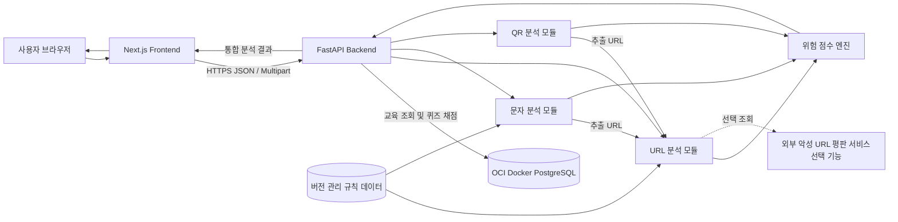

# 스미싱 예방 교육 및 탐지 시스템 아키텍처

- **문서 버전:** Draft v0.2
- **작성일:** 2026-10-11
- **검토 상태:** 팀 합의 전 제안안
- **관련 문서:** `01_Feature_Specification.md`, `02_User_Flow.md`
- **적용 범위:** MVP

## 1. 문서 목적

본 문서는 MVP 구현을 위한 Frontend, Backend, 분석 모듈, 파일 처리, 배포 및 보안 구조를 정의한다. 기능별 책임과 데이터 흐름을 명확히 나누어 FE와 BE가 동일한 기준으로 개발할 수 있도록 하는 것이 목적이다.

## 2. 현재 프로젝트 상태

2026-10-11 기준 저장소 상태는 다음과 같다.

- `KNUT-Capstone-Design-FE`: Git 저장소만 생성되어 있고 소스 코드와 커밋은 없음
- `KNUT-Capstone-Design-BE`: Git 저장소만 생성되어 있고 소스 코드와 커밋은 없음
- `KNUT-Capstone-Design-docs`: 기능 명세와 사용자 흐름 작성 중

기존 구현 제약이 없으므로 MVP 범위에 맞춰 기술 스택과 구조를 새로 결정한다.

## 3. 아키텍처 목표

- URL, 문자, QR 분석 기능을 독립적으로 개발하고 테스트할 수 있어야 한다.
- 검사 결과의 등급, 점수, 근거와 권장 행동 형식을 통일해야 한다.
- 외부 평판 서비스가 실패해도 내부 규칙 기반 분석이 동작해야 한다.
- 의심 URL에 서버가 직접 접속하지 않고도 기본 분석을 수행해야 한다.
- 업로드 이미지를 영구 저장하지 않아야 한다.
- MVP부터 OCI Docker PostgreSQL을 사용하고 이후 OCR·관리자 기능을 확장할 수 있어야 한다.
- FE와 BE를 각각 독립적으로 배포할 수 있어야 한다.

## 4. 기술 스택 제안

### 4.1 Frontend

- Next.js
- React
- TypeScript
- Tailwind CSS
- 네이티브 `fetch` 또는 프로젝트 표준 API 클라이언트
- Vitest 또는 Jest와 React Testing Library
- Playwright 기반 핵심 사용자 흐름 테스트

### 4.2 Backend

- Python 3
- FastAPI
- Pydantic 기반 요청·응답 검증
- Uvicorn 기반 애플리케이션 실행
- OpenCV 기반 QR 코드 탐지 및 디코딩
- pytest 기반 단위·통합 테스트

### 4.3 데이터 저장

사용자 결정에 따라 MVP부터 기존 OCI 서버에 Docker PostgreSQL을 운영한다. 교육·퀴즈 데이터의 기준 저장소로 사용하며 BE만 DB에 접속한다.

- 교육 사례·예방수칙·퀴즈 문제·선택지·정답·해설: PostgreSQL 저장, BE API 조회·채점
- 탐지 규칙: BE 저장소의 버전 관리되는 JSON 또는 Python 설정
- 검사 원문과 QR 이미지: 영구 저장하지 않음
- 로그: 개인정보와 원문을 제거한 운영 정보만 기록

스키마와 초기 seed는 BE에서 버전 관리한다. 데이터 모델·백업·마이그레이션 기준은 `04_Database_Design.md`를 따른다. 관리자 UI와 사용자 기록 저장은 여전히 MVP 밖이다.

## 5. 전체 시스템 구성



## 6. 저장소별 책임

### 6.1 Frontend 저장소

Frontend는 다음을 담당한다.

- 메인, URL 검사, 문자 검사, QR 검사 화면
- 공통 검사 결과 화면
- 입력값의 기본 형식과 크기 검증
- 분석 요청과 로딩·오류 상태 처리
- 위험 등급, 근거와 권장 행동 표시
- BE API로 교육 사례·퀴즈를 조회하고 UI 표시 및 답안 제출
- 접근성, 반응형 화면 및 사용자 경험
- Backend 응답을 사용자 화면 모델로 변환

Frontend가 담당하지 않는 항목은 다음과 같다.

- 최종 위험 점수와 등급 계산
- 치명 규칙 판정
- 악성 URL 평판 조회
- QR 원본 데이터의 신뢰성 판단
- 보안상 필요한 서버 측 파일 검증

### 6.2 Backend 저장소

Backend는 다음을 담당한다.

- API 요청과 입력값의 최종 검증
- URL 정규화와 구조 분석
- 문자 위험 키워드와 패턴 분석
- 문자에서 URL 추출
- QR 이미지 검증, 디코딩 및 임시 파일 정리
- 위험 점수 계산과 치명 규칙 적용
- 공통 응답 형식 생성
- 선택적 외부 악성 URL 평판 조회
- 개인정보를 제외한 로그와 오류 처리
- PostgreSQL 연결·교육 조회·퀴즈 채점·마이그레이션·seed 관리

Backend는 의심 URL에 직접 접속해 HTML을 내려받거나 실행하지 않는다. 동적 웹페이지 분석은 격리 환경이 준비되는 도전 기능으로 분리한다.

### 6.3 문서 저장소

문서 저장소는 다음을 담당한다.

- 기능 범위와 우선순위
- 사용자 흐름과 화면 ID
- 시스템 아키텍처와 기술 의사결정
- API 계약
- 테스트 기준과 프로젝트 일정
- 팀 합의 및 변경 이력

## 7. 분석 모듈 구조

### 7.1 공통 분석 인터페이스

각 분석 모듈은 가능한 한 다음 공통 결과를 반환한다.

```text
검사 유형
원시 점수
탐지 규칙 목록
치명 규칙 목록
세부 분석 결과
사용자용 판단 근거
```

점수 엔진은 모듈별 결과를 종합해 0~100점과 최종 등급을 생성한다.

### 7.2 URL 분석 모듈

담당 항목:

- URL 형식 검증과 정규화
- HTTP·HTTPS 프로토콜 검사
- IP 주소 직접 사용
- 단축 URL 패턴
- 도메인과 하위 도메인 구조
- 유사 문자 및 브랜드 사칭 패턴
- 로그인, 결제, 인증 및 다운로드 관련 경로
- APK 또는 실행 파일 확장자
- 내부 악성·공식 도메인 목록
- 선택적 외부 악성 URL 평판 조회

URL 문자열과 도메인만 분석하며 MVP에서는 대상 사이트에 직접 접속하지 않는다.

### 7.3 문자 분석 모듈

담당 항목:

- 문자 정규화
- 위험 키워드와 문장 패턴
- 긴급성, 공포, 혜택 강조 표현
- 기관·금융·택배·지인 사칭 표현
- 개인정보, 송금, 설치 유도 표현
- URL 추출 및 URL 분석 모듈 연계

문자는 패턴 점수와 성공한 URL 점수 중 최댓값을 사용한다. 치명 규칙은 합집합으로 반영한다. URL은 중복 제거 후 최대 5개 분석하고 생략·실패는 부분 결과로 안내한다.

### 7.4 QR 분석 모듈

담당 항목:

- PNG, JPG, JPEG 형식 및 MIME 타입 검증
- 최대 10MB 및 4096×4096 제한 검증
- 안전한 이미지 디코딩
- QR 데이터 추출
- URL 여부 판별
- URL인 경우 URL 분석 모듈 연계
- 임시 이미지 삭제

QR 데이터는 응답에서 클릭 가능한 링크가 아닌 문자열로 제공한다.

### 7.5 위험 점수 엔진

점수 엔진은 분석 모듈에서 전달된 규칙 결과를 기반으로 다음을 수행한다.

1. 탐지된 규칙의 배점을 합산한다.
2. 점수를 0~100 범위로 제한한다.
3. 점수에 따라 기본 등급을 결정한다.
4. 치명 규칙을 확인한다.
5. 필요한 경우 최종 등급을 `위험`으로 상향한다.
6. 사용자에게 표시할 근거와 권장 행동 코드를 생성한다.

점수 기준:

- 0~29: 안전
- 30~59: 주의
- 60~100: 위험

규칙별 배점은 코드에 흩어 두지 않고 한 곳에서 버전 관리한다.

## 8. 주요 데이터 흐름

### 8.1 URL 검사

```text
사용자 URL 입력
→ FE 기본 검증
→ Backend URL 분석 API
→ URL 정규화 및 규칙 분석
→ 선택적 외부 평판 조회
→ 점수·등급 계산
→ 공통 결과 응답
→ FE 결과 표시
```

### 8.2 문자 검사

```text
사용자 문자 입력
→ FE 5,000자 제한 검증
→ Backend 문자 분석 API
→ 문자 패턴 분석
→ URL 추출
→ URL 분석
→ 결과 종합
→ 점수·등급 계산
→ FE 결과 표시
```

### 8.3 QR 검사

```text
사용자 이미지 선택
→ FE 형식·용량 기본 검증 및 미리보기
→ Backend QR 분석 API
→ 서버 측 파일 재검증
→ QR 데이터 추출
→ URL이면 URL 분석
→ URL이면 점수·등급 계산, 비URL이면 risk=null
→ 임시 이미지 삭제
→ FE 결과 표시
```

## 9. API 통신 원칙

- 모든 운영 통신은 HTTPS를 사용한다.
- URL과 문자 분석은 JSON 요청을 사용한다.
- QR 분석은 `multipart/form-data`를 사용한다.
- API 경로에는 버전을 포함한다. 예: `/api/v1/analysis/url`
- 모든 분석 API는 공통 결과 구조와 공통 오류 구조를 사용한다.
- FE가 점수와 등급을 다시 계산하지 않고 BE 결과를 그대로 표시한다.
- 요청별 식별자를 응답에 포함해 오류 추적에 사용한다.
- 원문 URL, 문자와 QR 데이터를 로그에 기록하지 않는다.

세부 요청·응답은 `05_API_Specification.md`에서 정의한다.

## 10. QR 파일 처리 정책

### 10.1 검증

- 허용 확장자: `.png`, `.jpg`, `.jpeg`
- 허용 MIME 타입: `image/png`, `image/jpeg`
- 최대 파일 크기: 10,000,000 bytes(10MB), 요청 전체 11,000,000 bytes
- 최대 해상도: 4096×4096
- 제외: SVG, PDF, HEIC 및 애니메이션 이미지
- 확장자, MIME 타입과 실제 디코딩 가능 여부를 모두 검사한다.

### 10.2 저장 및 삭제

- 가능하면 파일을 메모리 또는 프로세스 임시 영역에서 처리한다.
- 디스크 저장이 필요한 경우 예측할 수 없는 임시 파일명을 사용한다.
- 정상 분석 완료 후 즉시 삭제한다.
- 실패, 중단 또는 프로세스 오류로 남은 파일도 업로드 후 10분 이내 삭제한다.
- 정리 작업은 주기적으로 임시 디렉터리를 확인하며 삭제 실패를 운영 로그에 기록한다.

## 11. 외부 서비스 연동

외부 악성 URL 평판 조회는 선택 기능으로 설계한다.

- 외부 서비스 없이도 내부 규칙 기반 분석이 동작해야 한다.
- 외부 서비스 호출은 별도 어댑터 인터페이스로 분리한다.
- API 키는 환경변수와 비밀 관리 기능으로 주입한다.
- 타임아웃과 호출 실패가 전체 분석 실패로 이어지지 않도록 한다.
- 외부 서비스 이용 약관과 URL 전송에 따른 개인정보 영향을 검토한다.
- 서비스 제공자는 팀 회의와 기술 검증 후 확정한다.

## 12. 오류 및 타임아웃 처리

### 12.1 오류 분류

- 입력 검증 오류
- 지원하지 않는 파일 오류
- QR 인식 실패
- 분석 처리 오류
- 외부 서비스 오류
- 서버 내부 오류

### 12.2 처리 원칙

- 사용자가 수정할 수 있는 오류와 서버 오류를 구분한다.
- 오류 응답에는 안정적인 오류 코드와 사용자용 메시지를 포함한다.
- 외부 서비스만 실패하면 내부 분석 결과와 경고를 반환한다.
- 서버 내부 오류에 스택 트레이스나 민감한 설정을 노출하지 않는다.
- 초기 타임아웃은 API 명세의 BE 분석 15초·FE 요청 30초로 두고 부하 테스트로 검증한다.
- DB 장애 시 교육·퀴즈 API는 503을 반환한다. 파일 기반 규칙을 사용하는 분석 API는 계속 제공할 수 있다.

## 13. 보안 및 개인정보 보호

- Backend에서 모든 입력을 다시 검증한다.
- 의심 URL을 자동으로 열거나 리디렉션하지 않는다.
- 원문 URL과 문자를 애플리케이션 로그에 남기지 않는다.
- QR 이미지를 영구 저장하지 않는다.
- 파일 경로를 사용자 입력으로 생성하지 않는다.
- CORS는 배포된 FE 출처로 제한한다.
- API 요청 크기와 요청 횟수를 제한한다.
- 오류 메시지에 내부 구현과 비밀정보를 노출하지 않는다.
- 의존성 취약점 점검과 테스트를 자동화한다.

## 14. 배포 구조 제안

### 14.1 Frontend

- Vercel 배포
- 운영 Backend 주소는 환경변수로 주입
- Preview 환경과 Production 환경 분리

### 14.2 Backend

- Oracle Cloud 인스턴스 또는 컨테이너 실행 환경
- Docker 이미지로 빌드
- HTTPS 리버스 프록시 구성
- 운영 환경변수와 외부 API 키는 저장소에 커밋하지 않음
- 상태 비저장 애플리케이션으로 운영

### 14.3 PostgreSQL 운영 결정

- 기존 OCI 서버에서 BE와 PostgreSQL을 별도 컨테이너로 구성하는 Docker Compose 구성을 제안한다.
- DB는 내부 Docker 네트워크에서만 접근하며 인터넷에 5432 포트를 공개하지 않는다.
- DB 데이터는 영속 볼륨에 둔다. 컨테이너 재생성 시 볼륨을 삭제하지 않는다.
- 애플리케이션 접속 계정과 마이그레이션 계정을 분리한다.
- 실제 이미지 버전·서버 자원·볼륨 경로는 배포 전 확인한다. 현재 DB가 설치됐다는 의미는 아니다.
- 자동 백업과 별도 위치 보관, 복원 시험을 배포 완료 조건으로 둔다.

### 14.4 배포 흐름

```text
FE 저장소 push
→ FE 테스트·빌드
→ Vercel 배포

BE 저장소 push
→ BE 테스트·Docker 빌드
→ DB 백업 및 마이그레이션
→ Oracle Cloud 배포
→ DB 연결 및 상태 확인
```

## 15. 테스트 전략

### 15.1 Frontend

- 입력 검증과 오류 메시지
- 로딩과 재시도 상태
- 공통 결과 컴포넌트
- 모바일·데스크톱 반응형 UI
- 메인부터 결과·교육까지 핵심 사용자 흐름

### 15.2 Backend

- URL 정규화와 규칙별 단위 테스트
- 문자 키워드와 URL 추출 테스트
- QR 정상·실패·위조 파일 테스트
- 점수 경계값 29·30·59·60 테스트
- 치명 규칙 등급 상향 테스트
- 외부 서비스 장애 시 부분 결과 테스트
- 파일 삭제와 로그 비식별화 테스트

### 15.3 계약 테스트

FE와 BE는 API 명세의 예제 요청·응답을 공통 기준으로 사용한다. Backend 응답 변경 시 API 문서와 FE 타입을 함께 검토한다.

## 16. 기술 의사결정

### ADR-001 FE와 BE 저장소 분리 유지

- **결정:** Next.js Frontend와 FastAPI Backend를 별도 저장소로 유지한다.
- **이유:** 책임과 배포를 분리하고 분석 기능을 Python 생태계로 확장하기 쉽다.

### ADR-002 OCI Docker PostgreSQL 사용

- **상태:** DB 사용·OCI·Docker는 사용자 확정. 테이블과 운영 상세는 PM 설계안.
- **결정:** MVP부터 교육·퀴즈 데이터를 PostgreSQL에 저장하고 BE API로 제공한다.
- **변경 이력:** 이전 DB 제외 제안을 대체한다.
- **범위:** 사용자 원문·이미지·검사 이력·퀴즈 제출은 영구 저장하지 않는다.

### ADR-003 규칙 기반 탐지를 기본으로 사용

- **결정:** 자체 AI 모델 학습 대신 설명 가능한 규칙과 배점으로 위험도를 계산한다.
- **이유:** 제한된 기간 안에 구현·테스트할 수 있고 사용자에게 판정 근거를 제공하기 쉽다.

### ADR-004 의심 URL 직접 접속 금지

- **결정:** MVP Backend는 분석 대상 URL의 웹페이지를 직접 요청하지 않는다.
- **이유:** SSRF, 악성 콘텐츠 실행, 네트워크 오용 위험을 줄인다.

### ADR-005 외부 평판 조회는 선택 기능

- **결정:** 외부 평판 조회 장애가 핵심 분석을 막지 않도록 선택적 어댑터로 구현한다.
- **이유:** API 할당량, 장애, 비용과 약관에 대한 의존성을 낮춘다.

## 17. 팀 회의 승인 항목

다음 항목은 팀 회의에서 승인 또는 수정한다.

- Frontend: Next.js, TypeScript, Tailwind CSS
- Backend: Python, FastAPI, OpenCV
- 사용자 확정인 OCI Docker PostgreSQL의 상세 자원·운영 설정 검토
- 교육·퀴즈 DB 모델과 BE 조회·채점 API 검토
- 탐지 규칙을 BE 버전 관리 파일로 관리
- 의심 URL 직접 접속 금지
- 외부 악성 URL 평판 조회를 선택 기능으로 분류
- FE Vercel, BE Oracle Cloud 배포

## 18. 후속 작업

1. 팀 회의에서 아키텍처와 기술 스택 승인
2. `04_Database_Design.md`와 `05_API_Specification.md` 초안 승인
3. FE·BE 초기 프로젝트 생성
4. 공통 분석 결과 모델과 오류 코드 구현
5. URL 분석 세로 단면 기능 우선 개발
6. 문자와 QR 분석 기능 확장
7. 배포 환경에서 통합 흐름 검증

---

본 문서는 기술 검증과 팀 합의에 따라 변경하며 주요 변경은 ADR 항목에 이유와 함께 기록한다.
